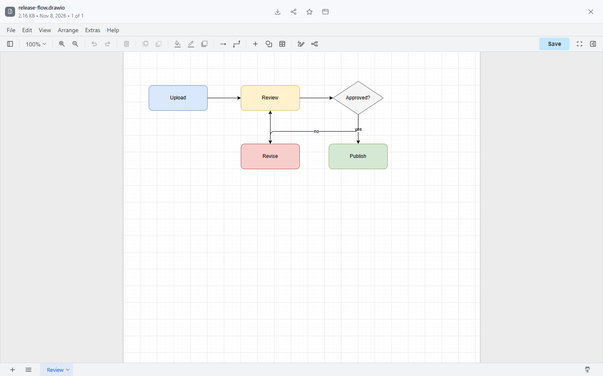
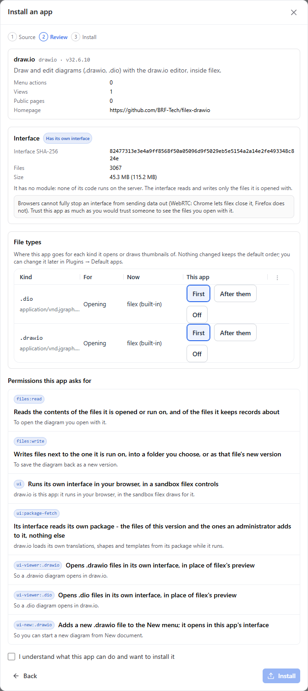
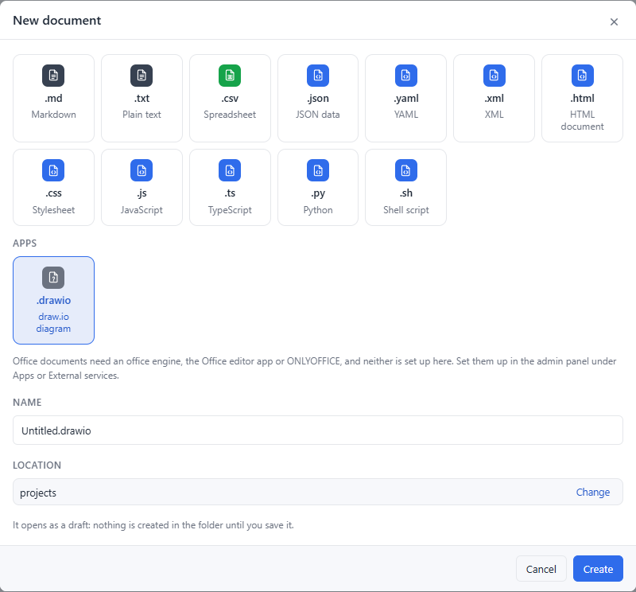

# filex-drawio

[draw.io](https://www.drawio.com) as a [filex](https://github.com/BRF-Tech/filex)
app. `.drawio` and `.dio` files open in the draw.io editor, inside filex, in
place of the preview. **Save** writes a new version of the file. filex's
**New document** dialog gets a **draw.io diagram** row.

It is an app with **its own interface and no module**: nothing of it runs on
the filex server. filex serves draw.io's own files from the app's package and
runs them in a sandboxed frame. The editor reads and saves only the file it
was opened with, through filex.



| | |
|---|---|
| draw.io | **32.7.7** ([release](https://github.com/jgraph/drawio/releases/tag/v32.6.10), pinned by sha256 in [`drawio.lock.json`](drawio.lock.json)) |
| Package (`ui.zip`) | **43.2 MiB** (45.3 MB) zipped, 115 MB unpacked, 3067 files |
| filex | **0.48.0** or later (`"filex": ">=0.48.0"`) |
| License | this repository MIT; draw.io Apache 2.0 - see [NOTICE](NOTICE) |

## Install

In filex's admin panel, **Plugins → Apps → Install an app → GitHub
repository**. Enter the repository `BRF-Tech/filex-drawio` and, if you want a
particular version, its tag as the ref (`v32.6.10`). filex reads [`filex-app.json`](filex-app.json), downloads
`ui.zip` from this repository's release, and checks it against the sha256
the manifest pins. A bundle that does not match is refused.

To install without GitHub, take `filex-app.json` and `ui.zip` from a
[release](https://github.com/BRF-Tech/filex-drawio/releases) and use
**Upload files** in the same dialog.

filex shows what the app asks for before you install it:



## What it asks for

| Permission | What it lets the app do |
|---|---|
| `files:read` | Read the diagram you open with it. |
| `files:write` | Save the diagram back as a new version, or save a new diagram. |
| `ui` | Run its own interface (draw.io) in your browser, in the sandbox filex controls. |
| `ui:package-fetch` | While it runs, read files from **its own package, this version only**. draw.io loads its translations, shapes and templates this way. The interface still cannot reach another app, filex's API or pages, or the network. |
| `ui-viewer:.drawio`, `ui-viewer:.dio` | Open these files in place of filex's preview. **Open with** chooses between apps when more than one opens a type. |
| `ui-new:.drawio` | Add **draw.io diagram** to **New document**. A new file starts as a blank page ([`template/blank.xml`](template/blank.xml)) and, where filex keeps drafts, is a draft until its first save. |

It asks for no `unsafe-eval` and no address outside its package, and it has
no module.



## How it is built

[`build.py`](build.py) makes `dist/ui.zip`:

- draw.io's own release, `draw.war`, as it is: every file except `WEB-INF/`
  and `META-INF/` (the Java servlet parts). The version and sha256 are pinned
  in `drawio.lock.json`, and a download that does not match is refused.
- `js/PreConfig.js`, the file draw.io loads first, with two scripts appended:
  - the filex interface SDK ([`vendor/filex-app-ui.iife.js`](vendor/));
  - [`filex-adapter.js`](filex-adapter.js), which puts draw.io in embed mode
    and speaks its embed protocol to filex. draw.io's `init` reads the file
    through filex, `autosave` marks the interface unsaved, and `save` saves
    through filex.
- `filex/blank.xml` (the new-document template), plus `LICENSE` and `NOTICE`.

Nothing else of draw.io changes.

```bash
python build.py            # downloads draw.war (pinned), writes dist/ui.zip, dist/ui.zip.sha256, dist/filex-app.json
python build.py --stamp    # also writes ui.bundle.url and ui.bundle.sha256 into filex-app.json
```

The build is **reproducible byte for byte** on any machine. draw.io's entries
are copied with their compressed bytes as they are, the entries this build
writes are stored uncompressed, and every entry has the same timestamp. This
matters because `filex-app.json` pins the bundle's sha256: the bundle CI
builds at a tag must be the one the manifest was stamped with. CI and the
release refuse a mismatch.

### Releasing

1. Change `drawio.lock.json` (version, url, sha256) and `filex-app.json`'s
   `version` to the new draw.io version.
2. Write the version's section in `CHANGELOG.md` (`## <version> - ...`, then
   what changed). It becomes the release's notes - what filex shows the
   administrator under **Release notes** when it offers the update.
3. Run `python build.py --stamp` and commit.
4. Tag `v<version>` and push the tag. The [release workflow](.github/workflows/release.yml)
   builds `ui.zip`, checks it against the pinned sha256, and attaches
   `ui.zip`, `ui.zip.sha256` and `filex-app.json` to the GitHub release, whose
   notes are the version's `CHANGELOG.md` section ([`release_body.py`](release_body.py);
   a version with no section is not released).

## Checked in real browsers

[`measure/drawio-measure.mjs`](measure/) installs the app into a filex and
drives it in Chrome, Firefox and WebKit with Playwright (headless, its own
input only): open a `.drawio` file, draw a shape from draw.io's Shapes panel,
**Save**, then **New document → draw.io diagram** and **Save to folder**.
[`measure/screenshots.mjs`](measure/) takes this page's pictures.

```bash
cd measure && npm install && npx playwright-core install chromium firefox webkit && cd ..
node measure/drawio-measure.mjs <path to a filex binary> dist/ui.zip
```

Last run (2026-11-08): draw.io 32.7.7 on filex 0.59.0 and on filex 0.48.1
(the oldest filex the manifest allows), the same in both, in Chrome 156,
Firefox 159 and WebKit 27.2.

| | Chrome | Firefox | WebKit |
|---|---|---|---|
| a `.drawio` file opens in draw.io | ✓ | ✓ | ✓ |
| draw a shape, **Save**: a new version on the storage (1 → 2 shapes) | ✓ | ✓ | ✓ |
| **New document → draw.io diagram**: a draft made from the template, open in draw.io | ✓ | ✓ | ✓ |
| draw, **Save**, **Save to folder**: the diagram lands in the folder | ✓ | ✓ | ✓ |
| content-policy violations | 0 | 0 | 0 |
| failed requests | 0 | 0 | 0 |

draw.io 31.5.3 requested a resource named `null` from its package twice
(Chrome blocked it, WebKit got a 404). With 32.6.10 no request failed, and
Chrome's and WebKit's consoles stayed empty.

## License

The code of this repository (the adapter, the build, the workflows, the
measurements) is MIT licensed ([LICENSE](LICENSE)).

`ui.zip` bundles **draw.io**, © JGraph Ltd, under the
[Apache License 2.0](LICENSES/drawio-Apache-2.0.txt). Parts of draw.io carry
licenses of their own, which ship with it. [NOTICE](NOTICE) lists them and
the changes this project makes. "draw.io" is a trademark of JGraph Ltd. This
project is not affiliated with or endorsed by JGraph Ltd.
